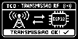
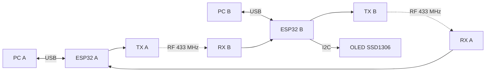
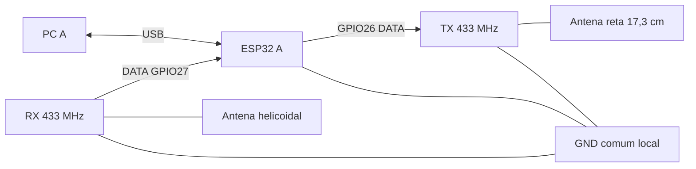
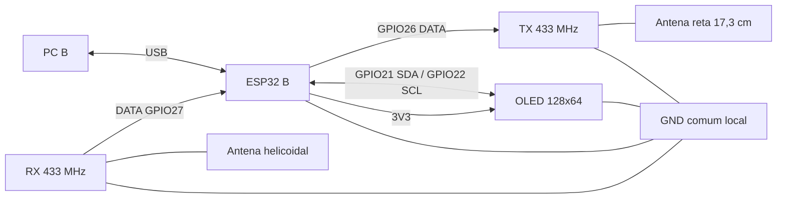
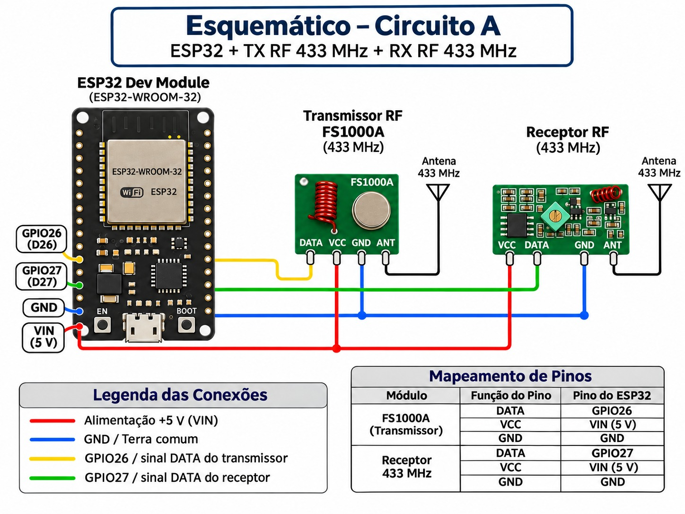
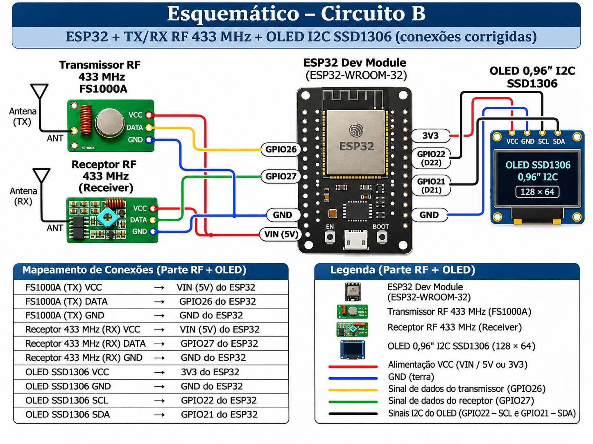
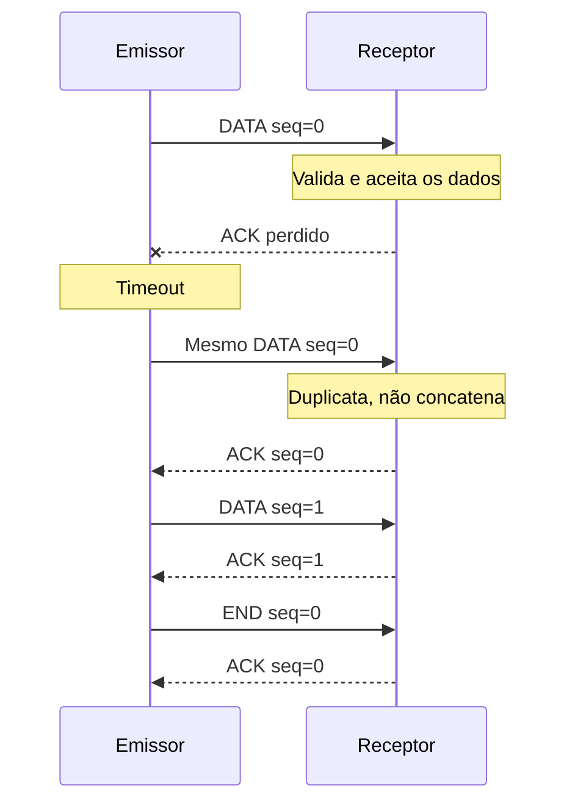

# TCD — Comunicação confiável via RF 433 MHz

Projeto final de **Transmissão e Comunicação de Dados** — IFMT, Campus Cuiabá – Octayde Jorge da Silva.

| Equipe | Professor | Entrega prevista |
| --- | --- | --- |
| Enzo Aurélio, Felipe Enzo e Enzo Christyan | Ruy Barbosa | 26/11/2026 |

**ESP32 · RF 433 MHz · CRC-8 · 4B6B · Stop-and-Wait ARQ · Texto e imagens bidirecionais**

O sistema conecta dois computadores por meio de dois ESP32. Cada computador comunica-se com sua placa via USB; entre as placas, os dados e ACKs trafegam exclusivamente pelo rádio. A versão de referência é a V7 original.

**Estado experimental: 14 ensaios executados conforme registros e relatos da equipe. T10 e T11 tiveram sucesso funcional; T12–T14 tiveram integridade confirmada por CRC32 e SHA-256. T06 permanece com comprovação parcial; não se afirma aprovação formal de todos os testes.**

<p align="center"></p>
<p align="center"><em>Arte de referência preparada em 128×64 para reprodução. Não é o arquivo reconstruído do ensaio original.</em></p>

### Relatório técnico

**[Consultar relatório técnico completo (PDF)](relatorio/Relatorio_TCD_Final.pdf)** · 52 páginas · LaTeX

Documentação do projeto com arquitetura, montagem, esquemáticos atualizados, protocolo, resultados e evidências dos 14 ensaios. Consulte também o [relatório de ensaios (PDF)](relatorio/Relatorio_Ensaios_V7.pdf) e o [projeto LaTeX editável](relatorio/latex/).

## 1. Códigos principais

Os quatro arquivos usados na bancada estão disponíveis separadamente. Seus conteúdos são idênticos aos originais V7; apenas os nomes foram adaptados à organização do repositório.

| Arquivo original | Acesso direto | Função |
| --- | --- | --- |
| Circuito_A_TCD_V7_IMAGENS(1).ino | [**Firmware Circuito A**](firmware/CircuitoA/CircuitoA.ino) | Transceptor RF, texto, imagens e ARQ |
| Circuito_B_TCD_V7_IMAGENS(1).ino | [**Firmware Circuito B**](firmware/CircuitoB/CircuitoB.ino) | Transceptor RF e OLED |
| enviar_imagem_TCD(1).py | [**Python — envio**](computador/enviar_imagem_TCD.py) | Conversão e transmissão de imagens |
| receber_imagem_TCD(1).py | [**Python — recepção**](computador/receber_imagem_TCD.py) | Validação e reconstrução PBM/PNG |

Outros arquivos: [Dependências Python](computador/requirements.txt) · [Imagem de referência](computador/exemplos/tcd_128x64.png) · [Enunciado](docs/enunciado.pdf) · [Relatório e evidências](relatorio/README.md).

### Acesso rápido — testes e acervos de imagens

| Acervo / documentação | Conteúdo |
| --- | --- |
| [**Relatório técnico completo (PDF)**](relatorio/Relatorio_TCD_Final.pdf) | Documento de 52 páginas com esquemáticos atualizados |
| [Relatório de ensaios V7 (PDF)](relatorio/Relatorio_Ensaios_V7.pdf) | Procedimentos, resultados e evidências de T01–T14 |
| [Projeto LaTeX](relatorio/latex/) | Fontes editáveis e figuras para Overleaf |
| [**Resultados experimentais**](#8-resultados-experimentais) | Procedimentos, resultados e contadores dos testes T01–T14 |
| [**Evidências por teste (T01–T14)**](relatorio/evidencias/README.md) | Capturas e fotografias dos ensaios disponíveis |
| [**Acervo geral de imagens**](relatorio/imagens/README.md) | Galeria visual do projeto |
| [Fotos selecionadas](relatorio/imagens/ens/01-fotos-selecionadas/) | Fotografias utilizadas no relatório |
| [Fotos originais](relatorio/imagens/ens/02-fotos-originais/) | Componentes, montagem dos circuitos e OLED |
| [Esquemáticos dos circuitos e antenas](relatorio/imagens/ens/03-esquematicos-finais/) | Diagramas de A, B e antenas TX/RX |
| [Imagens de transmissão](relatorio/imagens/ens/04-imagens-transmissao/) | Artes e imagens de referência |
| [Capturas dos testes](relatorio/imagens/ens/05-testes/) | Registros visuais organizados por ensaio |
| [Histórico de desenvolvimento](relatorio/imagens/ens/07-historico-desenvolvimento/) | Versões anteriores e ensaios preliminares |

Revisão de referência dos códigos: [35d4604](https://github.com/enzogomes2006/tcd-rf433-esp32/commit/35d4604424820aa82c8c3423637b6a23ae0019b2). Não substituir a V7 pela variante experimental V7R sem repetir a validação.

## 2. Arquitetura e montagem



### Materiais

| Quantidade | Componente | Função |
| ---: | --- | --- |
| 2 | ESP32 Dev Module | Processamento do protocolo |
| 2 | Transmissores RF 433 MHz (FS1000A, identificação visual) | Transmissão |
| 2 | Receptores RF 433 MHz (modelo exato não confirmado) | Recepção |
| 1 | OLED SSD1306 128×64 I²C | Exibição no B |
| 2 | Protoboards | Montagem |
| 2 | Cabos USB de dados | Alimentação/programação e comunicação local |
| 2 | Computadores | Interface com os ESP32 |
| 4 | Condutores de cabo Ethernet | Antenas artesanais |
| Conforme necessário | Jumpers, solda e ferro de soldar | Interligações e confecção |

### Circuito A — ligações funcionais



### Circuito B — ligações funcionais



| Sinal | A | B |
| --- | --- | --- |
| DATA TX | GPIO26 → TX | GPIO26 → TX |
| DATA RX | RX → GPIO27 | RX → GPIO27 |
| GND | Comum aos módulos locais | Comum aos módulos e OLED |
| SDA | — | GPIO21 |
| SCL | — | GPIO22 |
| VCC OLED | — | 3V3 |

Os desenhos são funcionais. A alimentação RF aparece como VIN/5 V nos desenhos anteriores, mas deve ser conferida com o módulo real. Verificar polaridade, tensão e nível lógico de DATA RX; **não aplicar 5 V diretamente ao GPIO do ESP32**. Usar adequação de nível se necessário.

Com os módulos desligados, montar as placas nas protoboards, soldar as antenas, interligar os sinais, alimentar corretamente os módulos e instalar o OLED somente no B. Conferir curtos antes de conectar USB. O OLED é monocromático logicamente, embora o painel físico seja amarelo/azul. O enunciado menciona LCD; confirmar com o docente a aceitação da substituição.

### Esquemáticos dos circuitos A e B

As figuras abaixo são os desenhos originais produzidos durante o desenvolvimento do projeto. Os arquivos em resolução original estão na [pasta de esquemáticos](relatorio/imagens/03-esquematicos-finais/).

**Circuito A — ESP32 e módulos TX/RX RF 433 MHz**



**Circuito B — ESP32, módulos TX/RX RF 433 MHz e OLED SSD1306**



> **Atenção:** os desenhos originais são ilustrativos e apresentam inconsistências gráficas nas ligações de alimentação, GND e OLED. Para montagem, siga o mapeamento funcional acima, confira a tensão dos módulos e não aplique 5 V diretamente aos GPIOs do ESP32.

## 3. Confecção e soldagem das antenas

Foram reaproveitados condutores de cabo de rede Ethernet. Os fios foram preparados e soldados aos pontos de antena dos módulos RF.

| Característica | TX (A e B) | RX (A e B) |
| --- | --- | --- |
| Material | Fio de cabo Ethernet | Fio de cabo Ethernet |
| Geometria | Reta, vertical | Helicoidal (mola) |
| Comprimento | **17,3 cm** | Sem comprimento padronizado |
| Fixação | Solda no ponto ANT | Solda no ponto ANT |

Para o monopolo TX, a referência de quarto de onda em espaço livre é:

**λ/4 = c/(4f) = 300.000.000/(4 × 433.000.000) ≈ 0,173 m = 17,3 cm.**

A geometria helicoidal do RX reduz a dimensão ocupada. Sua sintonia depende do comprimento do fio, número de espiras, diâmetro, espaçamento e montagem. Não foram medidas impedância, ganho ou ressonância, portanto não se afirma superioridade da antena helicoidal. Soldar com os módulos desenergizados, evitando pontes e esforço mecânico.

## 4. Instalação e gravação

1. Clonar com `git clone https://github.com/enzogomes2006/tcd-rf433-esp32.git` ou baixar ZIP pelo menu Code.
2. Instalar Arduino IDE e **esp32 by Espressif Systems**. A revisão anterior do repositório registra compilação com core 2.0.17 e placa ESP32 Dev Module.
3. Para B, instalar Adafruit SSD1306, Adafruit GFX Library e Adafruit BusIO.
4. Gravar separadamente o [sketch A](firmware/CircuitoA/CircuitoA.ino) e o [sketch B](firmware/CircuitoB/CircuitoB.ino).
5. Abrir os monitores seriais a **115200 baud**, final de linha **Nova linha**. Executar `/teste` nos dois; transmitir texto em ambos os sentidos, uma ponta por vez.

Portas mais recentes: A = COM17, B = COM9. Conferir a porta real em cada computador.

## 5. Protocolo

### Parâmetros V7

| Parâmetro | Valor |
| --- | --- |
| UART RF | 1200 baud, 8N1 |
| UART USB | 115200 baud |
| Preâmbulo | 32 bytes lógicos 0x2A, codificados em 4B6B |
| Quadro lógico | 21 bytes |
| Payload | Até 16 bytes por DATA |
| Texto | Até 512 bytes |
| FCS | CRC-8, polinômio 0x87 |
| ARQ | Stop-and-Wait, sequência 0/1 |
| Timeout ACK | 5000 ms |
| ACK | Duas cópias |
| Reenvio | Sem limite de tentativas |

### Estrutura do quadro

| Posição | Campo | Bytes | Descrição |
| --- | --- | ---: | --- |
| 0 | FLAG | 1 | 0x7E |
| 1 | TYPE | 1 | DATA=0, ACK=1, END=2 |
| 2 | SEQ | 1 | 0 ou 1 |
| 3 | LEN | 1 | 1–16 em DATA, 0 em ACK/END |
| 4–19 | DATA | 16 | Carga útil e preenchimento com zeros |
| 20 | FCS | 1 | CRC-8 dos bytes 1–19 |

### CRC-8 e cálculo do FCS

O acumulador inicia em 0x00. Para cada byte protegido, faz-se XOR e oito deslocamentos à esquerda, aplicando 0x87 quando o bit superior anterior é 1. Sem reflexão e sem XOR final. FLAG não entra no cálculo.

Exemplo: DATA seq=0, LEN=3, texto ASCII TCD. Os bytes protegidos são 00 00 03 54 43 44 seguidos de 13 zeros. **FCS = 0x16**. O quadro lógico completo:

```text
7E 00 00 03 54 43 44 00 00 00 00 00 00 00 00 00 00 00 00 00 16
```

### Codificação 4B6B

Cada nibble de 4 bits é convertido em símbolo de 6 bits, transportado em um byte da UART. Cada byte lógico gera dois símbolos.

| Nibble | 0 | 1 | 2 | 3 | 4 | 5 | 6 | 7 |
| --- | --- | --- | --- | --- | --- | --- | --- | --- |
| Símbolo hex | 0D | 0E | 13 | 15 | 16 | 19 | 1A | 1C |
| Nibble | 8 | 9 | A | B | C | D | E | F |
| Símbolo hex | 23 | 25 | 26 | 29 | 2A | 2C | 32 | 34 |

Símbolos inválidos e quadros com CRC incorreto são descartados sem ACK.

### Stop-and-Wait ARQ



O emissor só avança após ACK válido; o receptor reenvia ACK de duplicatas sem repetir o conteúdo. END também exige confirmação. A V7 espera 180 ms antes do ACK, transmite duas cópias separadas por 35 ms e aguarda 1200 ms após ACK válido. A comunicação opera em half-duplex. Se a outra placa estiver desligada, o firmware pode retransmitir indefinidamente; reiniciar ambos para cancelar e sincronizar nova sessão.

Funções para estudo nos sketches: `montarFrame`, `crc8`, `receberFrame`, `enviarComARQ`, `processarFrameRecebido`, `executarLote`.

## 6. Comandos do Monitor Serial

| Comando | Ponta | Finalidade |
| --- | --- | --- |
| /ajuda | A ou B | Lista comandos |
| /teste | A e B | Autoteste CRC e 4B6B |
| /status | A e B | Contadores |
| /zerarstats | A e B | Zera contadores, preserva estado RF |
| /erro | Emissor | Corrompe primeira tentativa do próximo DATA |
| /ruido N | Emissor | Injeta N corrupções por software |
| /perderack | Receptor | Omite uma vez as duas cópias do ACK DATA |
| /perderend | Receptor | Omite uma vez as duas cópias do ACK END |
| /lote N | Emissor | Lote de N mensagens (1–30) |
| Texto comum | Emissor | Transmite mensagem |
| /imgstart W H HEXCRC32, /imghex HEX, /imgend | Scripts Python | Interface de imagem |

**Atenção:** usar `/lote 10` com espaço e `/perderend`. Não usar `/lote10` ou `/perderackend`; são tratados como texto. O comando /ruido simula corrupção em software, não interferência física externa.

## 7. Transmissão de imagens

O Python ajusta proporção, converte para 1 bit por pixel, calcula CRC32 e SHA-256 dos pixels e salva um PBM de referência. O rádio transmite cabeçalho DATA de 16 bytes (TCDIM1, largura, altura, total uint16 LE, CRC32 uint32 LE, 2 reservados), seguido dos blocos de pixels e END.

| Resolução | Bytes de pixels | DATA de pixels | Quadros lógicos incluindo cabeçalho e END, sem ACK/reenvio |
| --- | ---: | ---: | ---: |
| 64×32 | 256 | 16 | 18 |
| 128×64 | 1024 | 64 | 66 |

O receptor valida tamanho e CRC32 antes de confirmar END. O script receptor reconstrói PBM/PNG e calcula SHA-256. Comparar hashes dos **pixels**, não dos arquivos completos.

### Preparação

Fechar monitores seriais. Na raiz do repositório, nos dois computadores:

```powershell
py -m pip install -r computador/requirements.txt
py -m serial.tools.list_ports
```

No Windows, também é possível usar python; no Linux/macOS, python3. Ajustar as portas.

### A → B (T12, 64×32)

Primeiro, no B:

```powershell
py computador/receber_imagem_TCD.py COM9
```

Depois, no A:

```powershell
py computador/enviar_imagem_TCD.py COM17 computador/exemplos/tcd_128x64.png --size 64x32 --sem-dither
```

Resultado de 24/11: 256/256 bytes, CRC32 DAF56504 e SHA-256 coincidente; 1,12 m em 112 s. END confirmado na segunda tentativa. A execução real utilizou COM20 (A) e COM8 (B). Os comandos acima são exemplos de reprodução, com arquivo de referência do repositório; a execução real utilizou imagem4.jpeg.

### A → B (T13, 128×64)

Com receptor B em execução:

```powershell
py computador/enviar_imagem_TCD.py COM17 computador/exemplos/tcd_128x64.png --size 128x64 --sem-dither
```

Resultado de 24/11: 1.024/1.024 bytes, CRC32 2749D731 e SHA-256 coincidente; duração de 720 s. Distância reduzida de 1,12 m para 0,60 m durante a sessão. END confirmado na primeira tentativa.

### B → A (T14)

Primeiro, no A:

```powershell
py computador/receber_imagem_TCD.py COM17
```

Depois, no B:

```powershell
py computador/enviar_imagem_TCD.py COM9 computador/exemplos/tcd_128x64.png --size 64x32 --sem-dither
```

Resultado de 24/11: imagem 64×32, 256/256 bytes, CRC32 607BACD6 e SHA-256 coincidente; 1,15 m, tempo estimado de 120–180 s na tentativa bem-sucedida. A primeira sessão foi interrompida; a execução bem-sucedida utilizou COM5 (B) e COM20 (A). O circuito A não possui OLED.

## Acervo de imagens do projeto

**[Acessar acervo geral de imagens](relatorio/imagens/README.md)** — fotografias, esquemáticos finais, imagens de transmissão e registros técnicos organizados por categoria. As imagens disponiveis estao publicadas nas galerias.

## 8. Resultados experimentais

**[Galeria de evidências por teste (T01–T14)](relatorio/evidencias/README.md)** — pastas individuais para as capturas e fotografias, com indicação dos registros disponíveis e pendentes.

Antes dos ensaios, concluir transmissões anteriores, zerar contadores em ambos os nós e registrar condições físicas. Após o teste, coletar logs e /status sem zerar os contadores.

| ID | Procedimento | Resultado | Evidência |
| --- | --- | --- | --- |
| T01 | /teste em A e B | CRC, detecção de alteração e 4B6B OK | Serial |
| T02 | Texto A → B | Entrega e END confirmado | Serial |
| T03 | Texto B → A | Entrega; 2 reenvios | Serial |
| T04 | Texto longo | Fragmentação, remontagem e entrega; 18 reenvios | Serial |
| T05 | /erro em A | 1 CRC errado detectado e recuperado | Serial |
| T06 | /ruido 3 em A | 3 CRCs errados no B; 1 mensagem contabilizada | Comprovação parcial: não há confirmação das duas mensagens previstas |
| T07 | /perderack em B | 1 omissão, recuperação e controle de duplicatas | Serial |
| T08 | /perderend em B | END confirmado na terceira tentativa | Serial, ressalva dos contadores |
| T09 | /lote 10 em curta distância | 10/10 recebidas | Serial, ressalva dos contadores |
| [T10](relatorio/evidencias/T10/) | Distância acima de 1 m | 10/10; 1,12 m; 19 reenvios | Sucesso funcional; fotos e logs |
| [T11](relatorio/evidencias/T11/) | Obstáculo passivo | 10/10 em ambas as condições | Sucesso funcional; fotos e logs |
| [T12](relatorio/evidencias/T12/) | Imagem 64×32 A → B | 256 bytes; 112 s; 1,12 m | Integridade confirmada; PBM, hashes e OLED |
| [T13](relatorio/evidencias/T13/) | Imagem 128×64 A → B | 1.024 bytes; 720 s; distância variável | Integridade confirmada; PBM, hashes e OLED |
| [T14](relatorio/evidencias/T14/) | Imagem 64×32 B → A | 256 bytes; 1,15 m; 120–180 s estimados | Integridade confirmada; PBM, hashes e PNG |

### Contadores observados

| ID | Emissor | TX frames | ACK recebidos | Reenvios | CRC errado no receptor | Duplicatas no receptor | Msg. recebidas |
| --- | --- | ---: | ---: | ---: | ---: | ---: | ---: |
| T03 | B | 5 | 3 | 2 | 0 | 0 | 1 |
| T04 | A | 23 | 5 | 18 | 0 | 18 | 1 |
| T05 | A | 4 | 3 | 1 | 1 | 0 | 1 |
| T06 | A | 10 | 4 | 6 | 3 | 3 | 1 |
| T07 | A | 8 | 3 | 5 | 0 | 5 | 1 |
| T08 | A | 15 | 3 | 8 | 0 | 8 | 1 |
| T09 | A | 145 | 32 | 113 | 0 | 107 | 10 |
| T10 | A | 49 | 30 | 19 | 0 | 19 | 10 |
| T11 sem mochila | A | 44 | 30 | 14 | 0 | 14 | 10 |
| T11 com mochila | A | 43 | 30 | 13 | 0 | 13 | 10 |

T08: contadores incluem atividade residual; não atribuir todos os reenvios à omissão do END. T09: A contabilizou 11 mensagens enviadas, B recebeu 137 quadros válidos, 107 duplicatas e 10 mensagens completas. Os 30 quadros novos são coerentes com 2 DATA e 1 END por mensagem. Não calcular taxa exclusiva do lote a partir de contadores acumulados.

A entrega foi bem-sucedida nos ensaios relatados, mas muitas retransmissões e descartes 4B6B indicam baixa eficiência do enlace em algumas condições. O protocolo recupera falhas observadas, não torna o canal imune a ruído.

### Integridade das imagens e condições dos ensaios

| Teste | Pixels (bytes) | Distância | Tempo | CRC32 |
| --- | ---: | --- | --- | --- |
| T12 | 256 | 1,12 m | 112 s | `DAF56504` |
| T13 | 1.024 | 1,12 → 0,60 m | 720 s | `2749D731` |
| T14 | 256 | 1,15 m | 120–180 s (estimado) | `607BACD6` |

SHA-256 dos pixels (coincidente entre emissão, recepção e PBM em cada ensaio):

- T12: `80c42a279aaed29daa665e3ac66efb650d83e8d8bb86042519505986162c22f7`
- T13: `4a9fee35ec9e4c6a73b0491bc91053fb49b46081fc9a32180939efd8ee7cae3e`
- T14: `44b987a65d8511998c873caf6dbfe238a7006d68e8ec7152df4d82ffc2c71a92`

T10: tempo estimado de 120–180 s. T11: 176 s com mochila e 200 s sem mochila; a diferença não demonstra melhora causada pelo obstáculo. T13 teve redução de distância durante a transmissão. T14 teve uma primeira tentativa interrompida; o tempo estimado corresponde à sessão bem-sucedida. Contadores totais de retransmissão de imagens não registrados. T06 permanece parcial; T10–T11 não exibem os dez textos integrais. T12–T13 têm PBM e hashes verificados, mas os PNGs originais não foram disponibilizados com identificação inequívoca. Fonte: [Relatório de ensaios V7, 24/11/2026](relatorio/Relatorio_Ensaios_V7.pdf).

## 9. Relatório e demonstração

Consultar o [relatório técnico completo (PDF)](relatorio/Relatorio_TCD_Final.pdf), o [relatório de ensaios](relatorio/Relatorio_Ensaios_V7.pdf), o [projeto LaTeX editável](relatorio/latex/) e a [documentação complementar](relatorio/README.md). O documento contempla montagem, esquemáticos atualizados, antenas, protocolo, FCS e os resultados consolidados dos 14 testes.

Na demonstração, mostrar circuitos e antenas, texto bidirecional e OLED, autoteste, descarte por CRC e retransmissão, omissão de ACK, distância acima de 1 m, condição física adversa e imagem reconstruída com comparação dos hashes.

O firmware e scripts foram desenvolvidos com apoio de IA e devem ser compreendidos e revisados pela equipe, observando os critérios de autoria e demonstração do [enunciado](docs/enunciado.pdf). Referência de estudo utilizada no desenvolvimento: [lxinaider/esp32-rf433-arq](https://github.com/lxinaider/esp32-rf433-arq).
