# Galeria de evidências experimentais — TCD

[Voltar ao README principal](../../README.md) · [Relatório](../README.md)

Cada teste possui pasta independente, numerada de T01 a T14. A descrição identifica a origem e as limitações do registro. As capturas e fotografias originais estão organizadas no pacote de evidências da equipe, publicadas nas respectivas pastas. Não há imagens de teste inventadas.

| Teste | Ensaio | Arquivos disponíveis no acervo |
| --- | --- | --- |
| [T01](T01/) | Validação local CRC-8 e 4B6B | 2 registro(s) no acervo |
| [T02](T02/) | Texto A → B | 1 registro(s) no acervo |
| [T03](T03/) | Texto B → A | 1 registro(s) no acervo |
| [T04](T04/) | Fragmentação de texto longo | 1 registro(s) no acervo |
| [T05](T05/) | Detecção de erro e retransmissão | 1 registro(s) no acervo |
| [T06](T06/) | Três erros simulados | 2 registro(s) no acervo |
| [T07](T07/) | Perda de ACK DATA | 2 registro(s) no acervo |
| [T08](T08/) | Perda de ACK END | 2 registro(s) no acervo |
| [T09](T09/) | Lote de dez mensagens | 3 registro(s) no acervo |
| [T10](T10/) | Comunicação à distância | 5 registro(s) no acervo |
| [T11](T11/) | Obstáculos e perturbações | 6 registro(s) no acervo |
| [T12](T12/) | Imagem 64×32 A → B | 5 registro(s) no acervo |
| [T13](T13/) | Imagem 128×64 A → B | 6 registro(s) no acervo |
| [T14](T14/) | Imagem B → A | 6 registro(s) no acervo |

T01–T14 possuem registros visuais no acervo. As novas figuras de T10–T14 foram extraídas do [relatório de ensaios V7 (PDF)](../Relatorio_Ensaios_V7.pdf). T06 mantém comprovação parcial; T10–T11 têm sucesso funcional, e T12–T14 têm integridade confirmada.

<!-- TCD-GALERIA-INICIO -->
## Galeria de imagens

Total de arquivos: 43.

### T01

<a href="T01/circuito-a.png">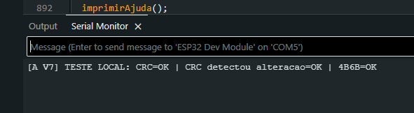</a>

### T02

### T03

<a href="T03/circuito-a.png">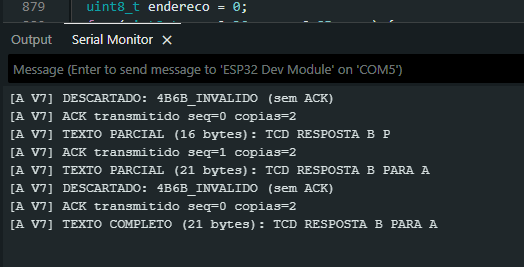</a>

### T04

<a href="T04/circuito-b.png">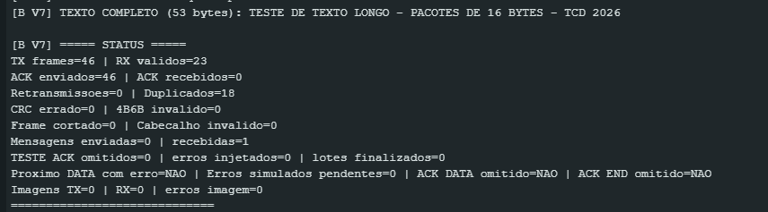</a>

### T05

<a href="T05/circuito-b.png">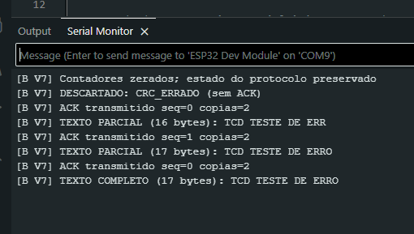</a>

### T06

### T07

<a href="T07/circuito-a.png">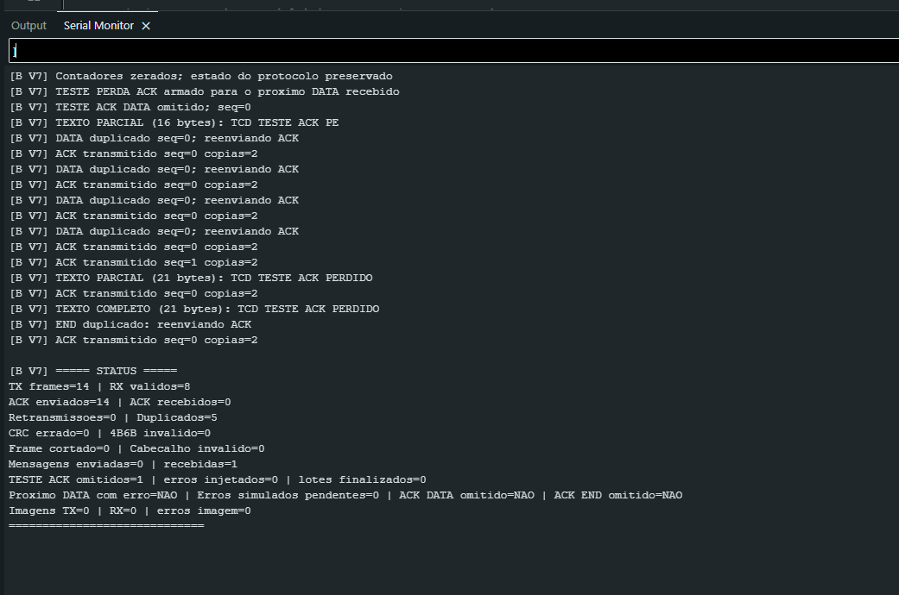</a>

<a href="T07/circuito-b.png">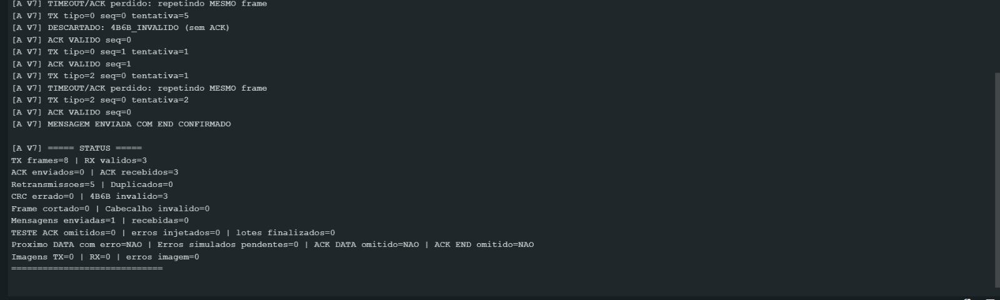</a>

### T08

<a href="T08/circuito-a.png">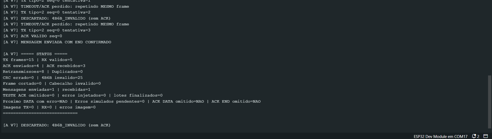</a>

<a href="T08/circuito-b.png">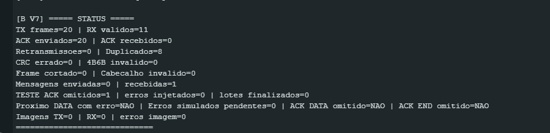</a>

### T09

<a href="T09/circuito-a.png">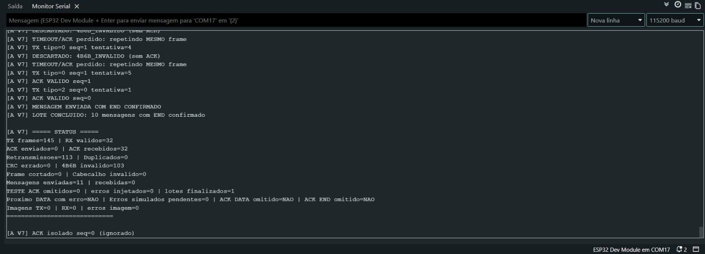</a>

<a href="T09/circuito-b.png">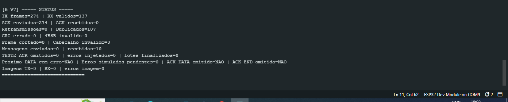</a>

### T13

### T10 — Comunicação RF a mais de 1 metro

10/10 mensagens e END confirmados a 1,12 m; 19 retransmissões. Tempo estimado de 120–180 s. As capturas não mostram os dez textos integrais.

**Bancada com trena e circuitos separados**

**Detalhe da medição**

<a href="T10/medicao.jpeg">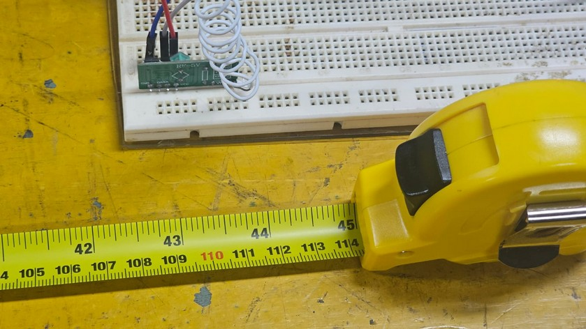</a>

**Montagem do receptor B**

<a href="T10/montagem-b.jpeg">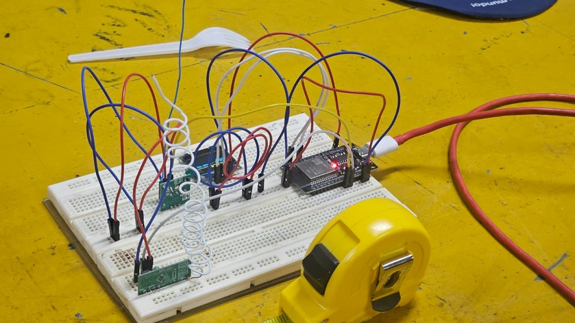</a>

**Circuito A: lote concluído e 19 retransmissões**

<a href="T10/serial-a.png">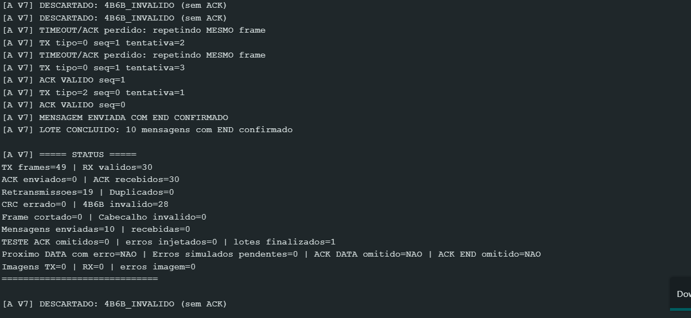</a>

**Circuito B: 10 mensagens e 19 duplicatas**

<a href="T10/serial-b.jpeg">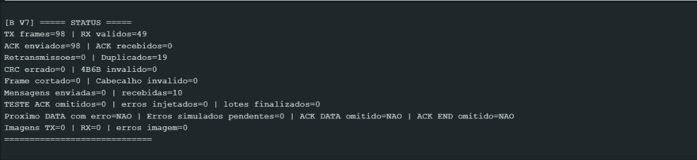</a>

### T11 — Obstáculo físico

10/10 mensagens e END nas duas condições, a 1,12 m. Com mochila: 176 s e 13 reenvios; sem mochila: 200 s e 14 reenvios. A foto sem mochila é a referência do T10; a diferença não demonstra benefício causado pelo obstáculo.

**Condição livre: foto de referência do T10**

<a href="T11/referencia-sem-obstaculo.jpeg">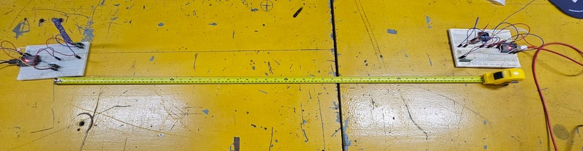</a>

**Mochila interposta**

<a href="T11/mochila.jpeg">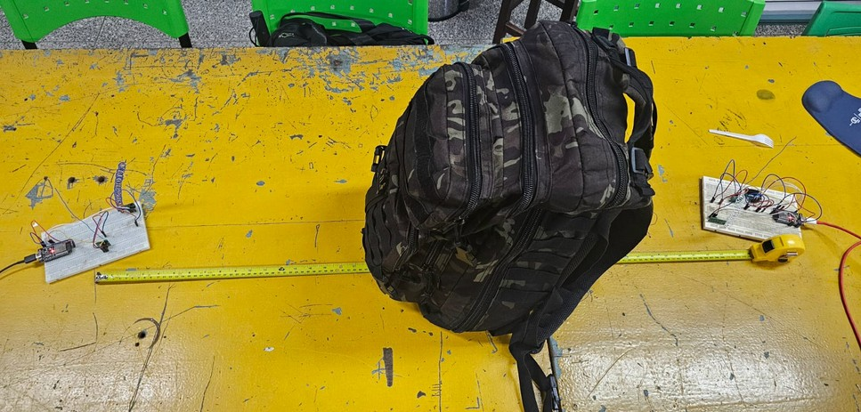</a>

**A: lote com mochila**

<a href="T11/a-com-mochila.png">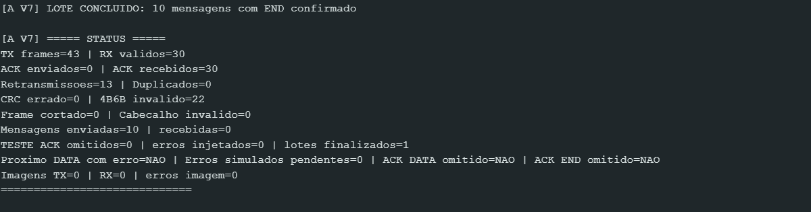</a>

**B: recepção com mochila**

<a href="T11/b-com-mochila.jpeg">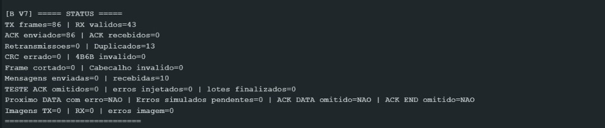</a>

**A: lote sem mochila**

<a href="T11/a-sem-mochila.png">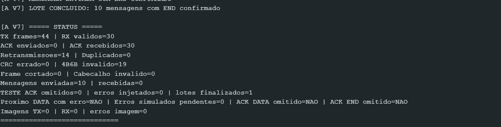</a>

**B: recepção sem mochila**

<a href="T11/b-sem-mochila.jpeg">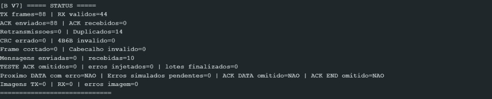</a>

### T12 — Imagem 64×32 A → B

256/256 bytes, 1,12 m, 112 s, CRC32 DAF56504; SHA-256 dos pixels coincidente. END na segunda tentativa. ClearCommError após validação e salvamento, sem invalidar o arquivo.

**PBM reconstruído, ampliado sem interpolação**

<a href="T12/pbm-ampliado.png">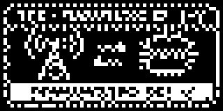</a>

**Imagem centralizada no OLED B**

<a href="T12/oled.jpeg">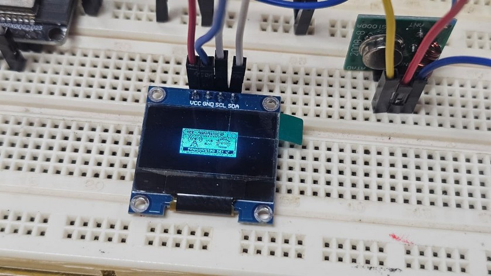</a>

**A: parâmetros e hashes antes do envio**

<a href="T12/a-inicio.png">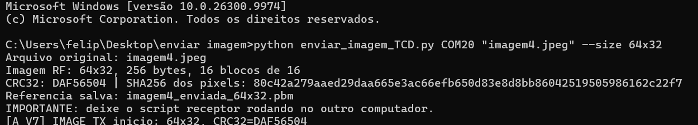</a>

**A: 256/256 bytes e confirmação RF**

<a href="T12/a-conclusao.png">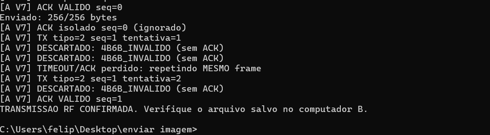</a>

**B: hashes e salvamento; erro serial posterior**

<a href="T12/b-validacao.jpeg">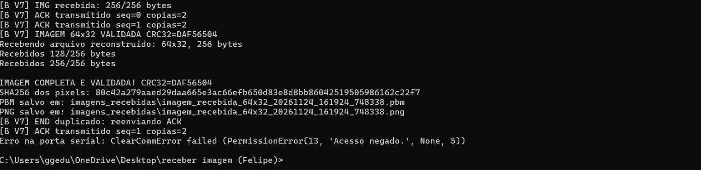</a>

### T13 — Imagem 128×64 A → B

1.024/1.024 bytes, 720 s, CRC32 2749D731; SHA-256 dos pixels coincidente. Distância reduzida de 1,12 m para 0,60 m durante a sessão; END na primeira tentativa.

**PBM reconstruído ampliado**

<a href="T13/pbm-ampliado.png">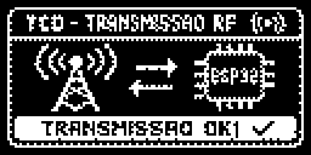</a>

**Imagem ocupando o OLED B**

<a href="T13/oled-validacao.jpeg">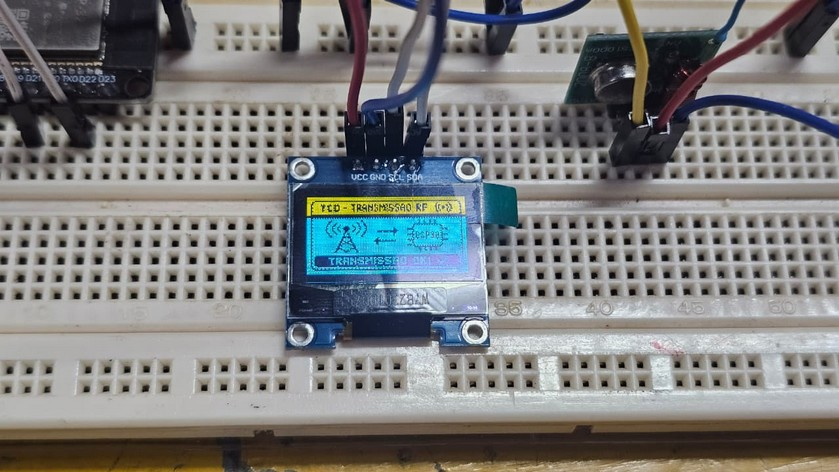</a>

**A: resolução e hashes**

<a href="T13/a-inicio.png">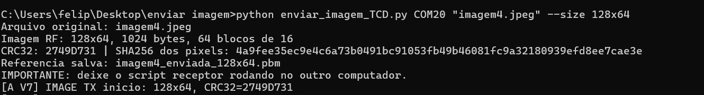</a>

**A: envio completo e END confirmado**

<a href="T13/a-conclusao.png">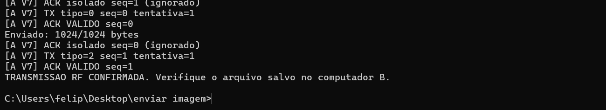</a>

**B: validação, hashes e arquivos reconstruídos**

<a href="T13/b-validacao.jpeg">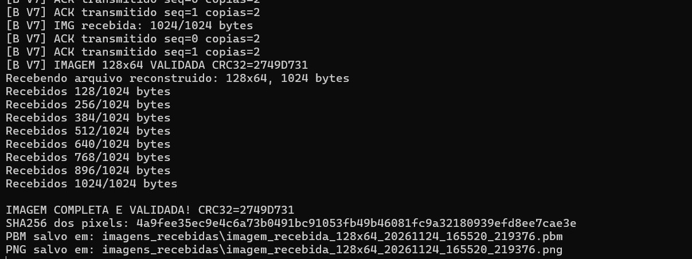</a>

### T14 — Imagem 64×32 B → A

256/256 bytes, 1,15 m, tempo estimado de 120–180 s na tentativa bem-sucedida, CRC32 607BACD6; SHA-256 dos pixels coincidente. Primeira tentativa interrompida; nova sessão confirmou cabeçalho na quarta tentativa e END na segunda.

**PBM reconstruído em A, ampliado**

<a href="T14/pbm-ampliado.png">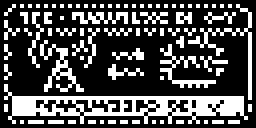</a>

**Montagens e trena**

<a href="T14/bancada-trena.jpeg">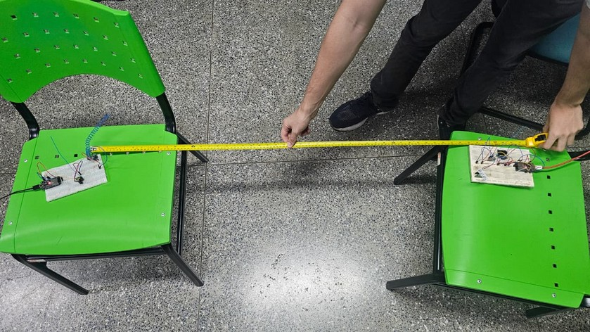</a>

**B: parâmetros e hashes antes do envio**

<a href="T14/b-inicio.jpeg">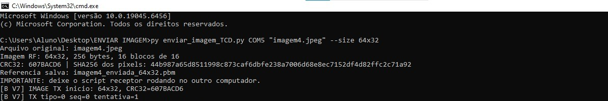</a>

**B: envio completo e END confirmado**

<a href="T14/b-conclusao.jpeg">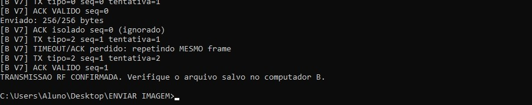</a>

**A: validação, hashes e arquivos salvos**

<a href="T14/a-validacao.png">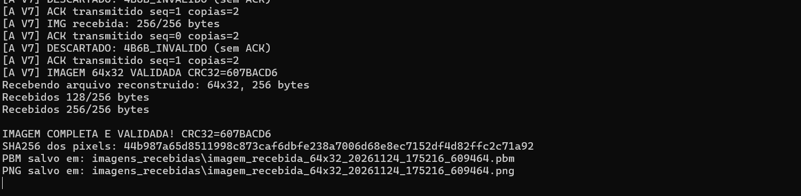</a>

**Primeira tentativa: timeouts e interrupção manual**

<a href="T14/tentativa-interrompida.jpeg">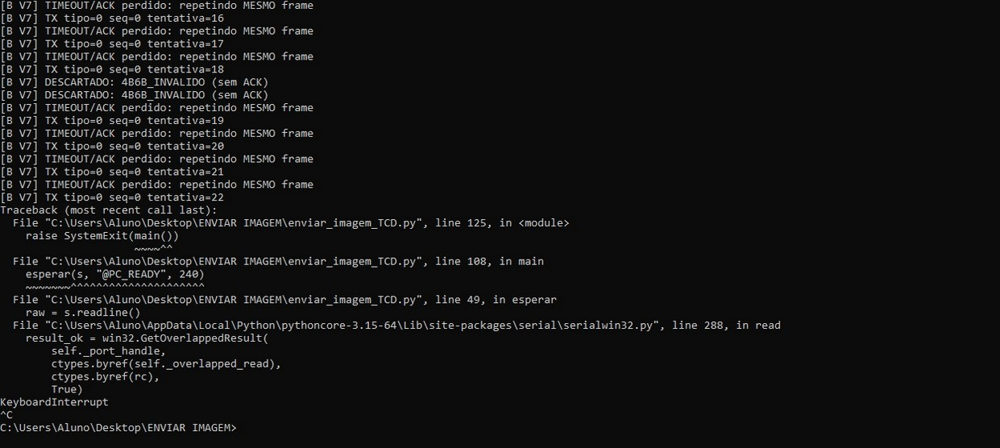</a>

<!-- TCD-GALERIA-FIM -->
