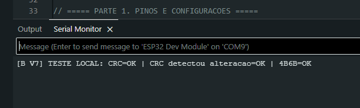
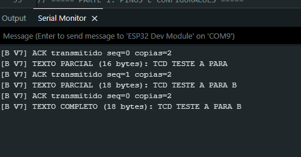
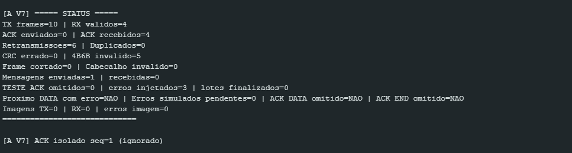
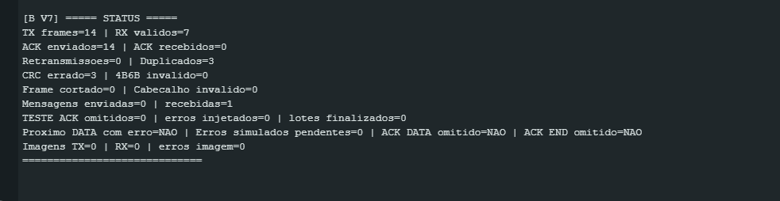
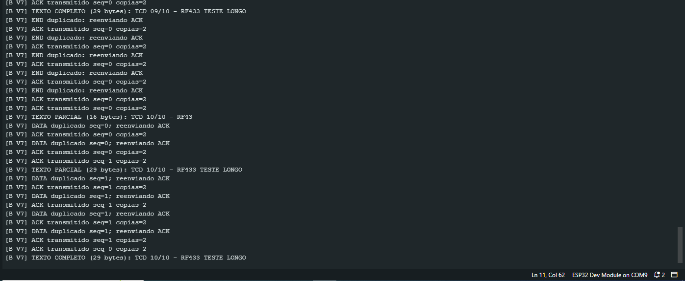

# Galeria de evidências experimentais — TCD

[Voltar ao README principal](../../README.md) · [Relatório](../README.md)

Cada teste possui pasta independente, numerada de T01 a T14. A descrição identifica a origem e as limitações do registro. As capturas e fotografias originais estão organizadas no pacote de evidências da equipe, publicadas nas respectivas pastas. Não há imagens de teste inventadas.

| Teste | Ensaio | Arquivos disponíveis no acervo |
| --- | --- | --- |
| [T01](T01/) | Validação local CRC-8 e 4B6B | 2 registro(s) no acervo |
| [T02](T02/) | Texto A → B | 1 registro(s) no acervo |
| [T03](T03/) | Texto B → A | 1 registro(s) no acervo |
| [T04](T04/) | Fragmentação de texto longo | 1 registro(s) no acervo |
| [T05](T05/) | Detecção de erro e retransmissão | 1 registro(s) no acervo |
| [T06](T06/) | Três erros simulados | 2 registro(s) no acervo |
| [T07](T07/) | Perda de ACK DATA | 2 registro(s) no acervo |
| [T08](T08/) | Perda de ACK END | 2 registro(s) no acervo |
| [T09](T09/) | Lote de dez mensagens | 3 registro(s) no acervo |
| [T10](T10/) | Comunicação à distância | Sem captura específica |
| [T11](T11/) | Obstáculos e perturbações | Sem captura específica |
| [T12](T12/) | Imagem 64×32 A → B | Pendente |
| [T13](T13/) | Imagem 128×64 A → B | 1 registro(s) no acervo |
| [T14](T14/) | Imagem B → A | Sem captura específica |

T01–T09 e T13 possuem registros visuais. T10, T11 e T14 foram relatados pela equipe sem evidências visuais específicas; T12 está pendente.

<!-- TCD-GALERIA-INICIO -->
## Galeria de imagens

Total de arquivos: 16.

### T01

### T02

### T03

### T04

### T05

### T06

### T07

### T08

### T09

### T13

<!-- TCD-GALERIA-FIM -->
