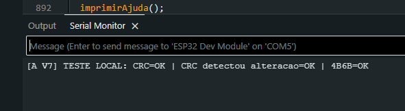
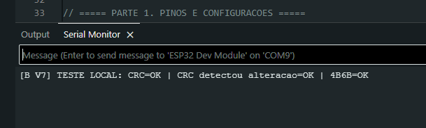

# T01 — Validação local CRC-8 e 4B6B

[Voltar à galeria](../README.md)

Autoteste local nas duas placas; CRC, detecção de alteração e 4B6B OK.

## Arquivos originais

- `circuito-a.png`
- `circuito-b.png`

As imagens disponiveis estao na galeria abaixo.

<!-- TCD-GALERIA-INICIO -->
## Galeria de imagens

Total de arquivos: 2.

<!-- TCD-GALERIA-FIM -->
