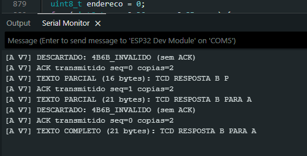

# T03 — Texto B → A

[Voltar à galeria](../README.md)

Recepção no circuito A; duas retransmissões registradas no emissor.

## Arquivos originais

- `circuito-a.png`

As imagens disponiveis estao na galeria abaixo.

<!-- TCD-GALERIA-INICIO -->
## Galeria de imagens

Total de arquivos: 1.

<!-- TCD-GALERIA-FIM -->
