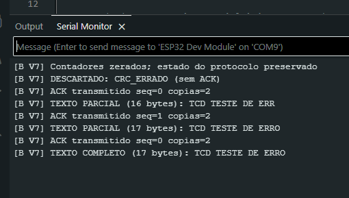

# T05 — Detecção de erro e retransmissão

[Voltar à galeria](../README.md)

CRC incorreto detectado no B após injeção de erro; recuperação.

## Arquivos originais

- `circuito-b.png`

As imagens disponiveis estao na galeria abaixo.

<!-- TCD-GALERIA-INICIO -->
## Galeria de imagens

Total de arquivos: 1.

<!-- TCD-GALERIA-FIM -->
