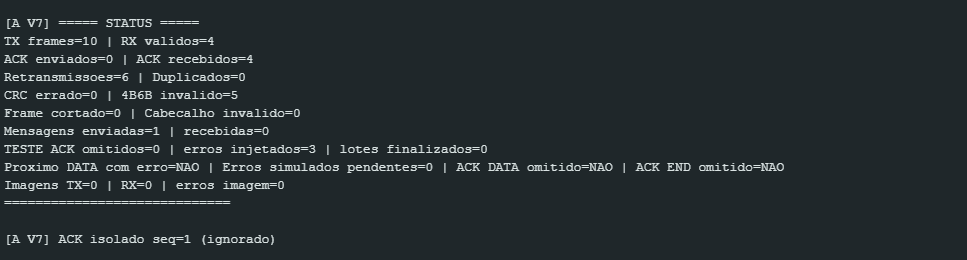
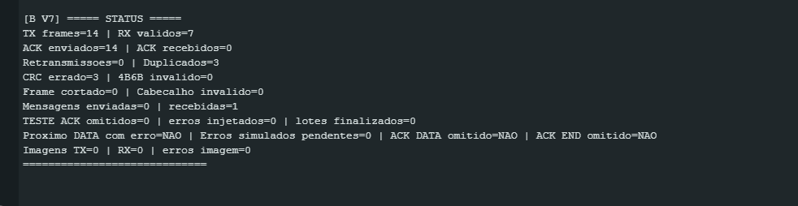

# T06 — Três erros simulados

[Voltar à galeria](../README.md)

Contadores registram três erros CRC no B e entrega; a captura não mostra o texto integral.

## Arquivos originais

- `circuito-a.png`
- `circuito-b.png`

As imagens disponiveis estao na galeria abaixo.

<!-- TCD-GALERIA-INICIO -->
## Galeria de imagens

Total de arquivos: 2.

<!-- TCD-GALERIA-FIM -->
