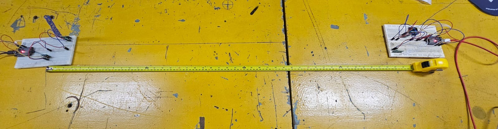
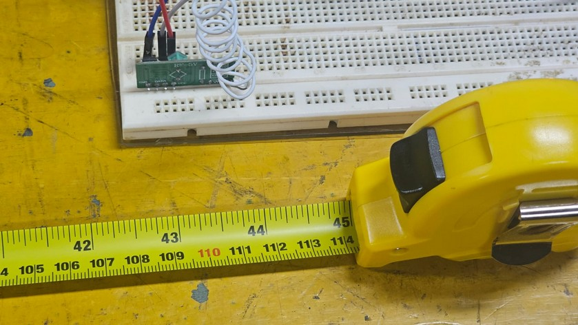
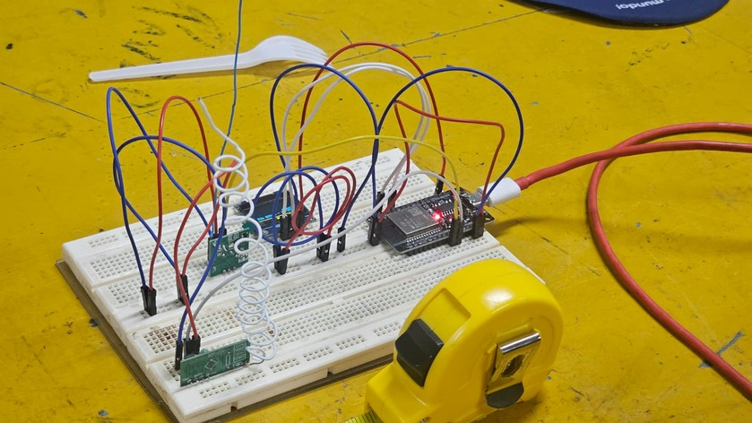
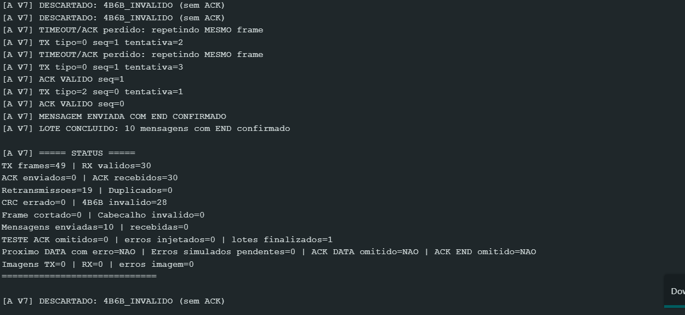
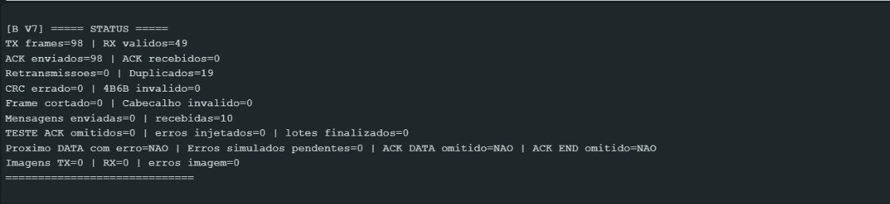

# T10 — Comunicação RF a mais de 1 metro

[Voltar à galeria](../README.md) · [Relatório de ensaios (PDF)](../../Relatorio_Ensaios_V7.pdf)

10/10 mensagens e END confirmados a 1,12 m; 19 retransmissões. Tempo estimado de 120–180 s. As capturas não mostram os dez textos integrais.

## Evidências visuais

Figuras extraídas do relatório de ensaios de 24/11/2026; não são novas medições.

**Bancada com trena e circuitos separados**

**Detalhe da medição**

**Montagem do receptor B**

**Circuito A: lote concluído e 19 retransmissões**

**Circuito B: 10 mensagens e 19 duplicatas**

