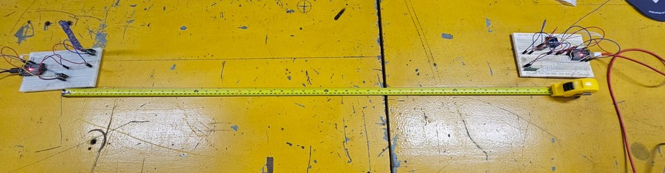
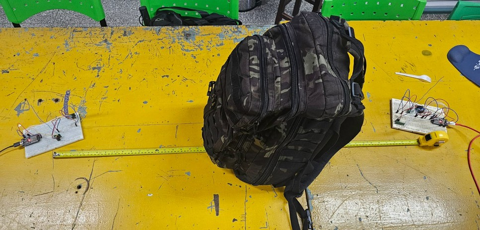
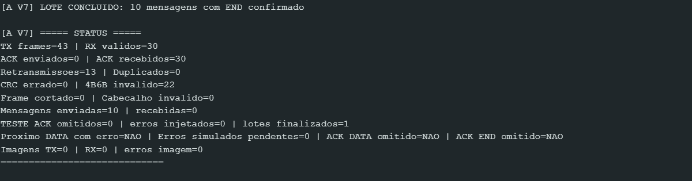
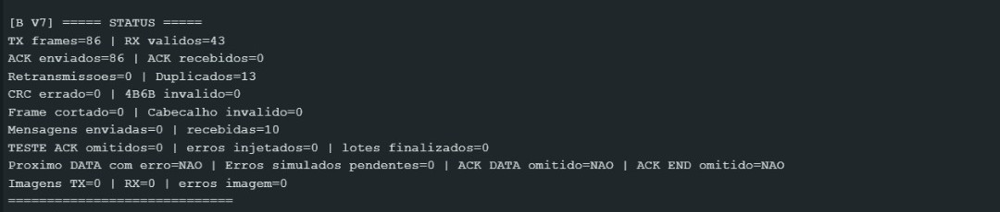
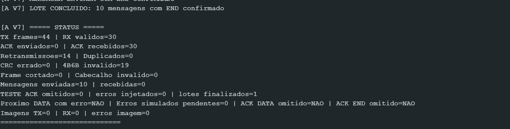
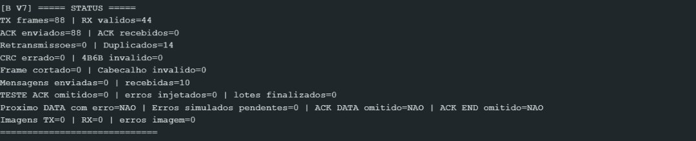

# T11 — Obstáculo físico

[Voltar à galeria](../README.md) · [Relatório de ensaios (PDF)](../../Relatorio_Ensaios_V7.pdf)

10/10 mensagens e END nas duas condições, a 1,12 m. Com mochila: 176 s e 13 reenvios; sem mochila: 200 s e 14 reenvios. A foto sem mochila é a referência do T10; a diferença não demonstra benefício causado pelo obstáculo.

## Evidências visuais

Figuras extraídas do relatório de ensaios de 24/11/2026; não são novas medições.

**Condição livre: foto de referência do T10**

**Mochila interposta**

**A: lote com mochila**

**B: recepção com mochila**

**A: lote sem mochila**

**B: recepção sem mochila**

