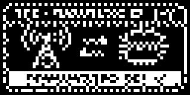
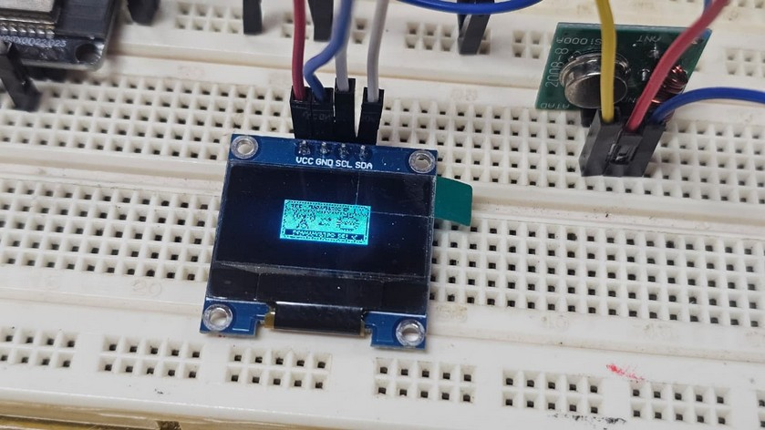
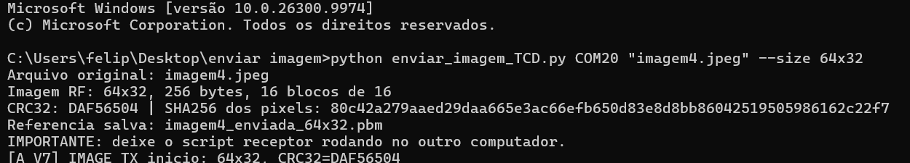
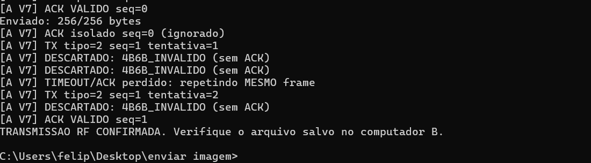
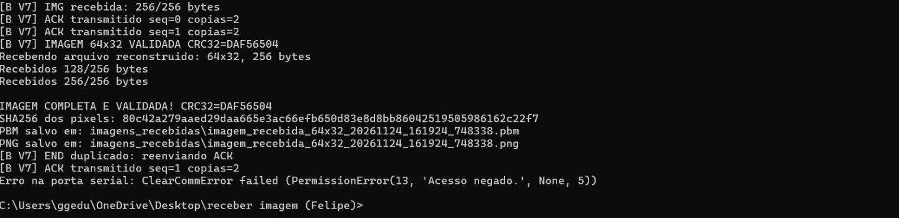

# T12 — Imagem 64×32 A → B

[Voltar à galeria](../README.md) · [Relatório de ensaios (PDF)](../../Relatorio_Ensaios_V7.pdf)

256/256 bytes, 1,12 m, 112 s, CRC32 DAF56504; SHA-256 dos pixels coincidente. END na segunda tentativa. ClearCommError após validação e salvamento, sem invalidar o arquivo.

## Evidências visuais

Figuras extraídas do relatório de ensaios de 24/11/2026; não são novas medições.

**PBM reconstruído, ampliado sem interpolação**

**Imagem centralizada no OLED B**

**A: parâmetros e hashes antes do envio**

**A: 256/256 bytes e confirmação RF**

**B: hashes e salvamento; erro serial posterior**

