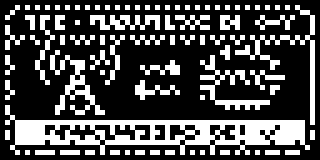
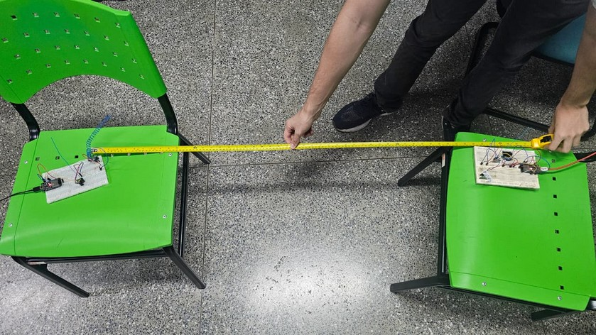
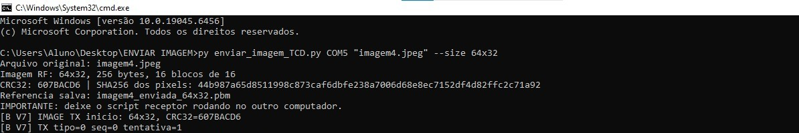
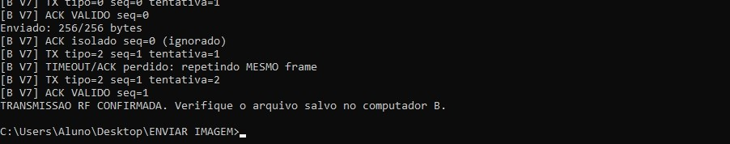
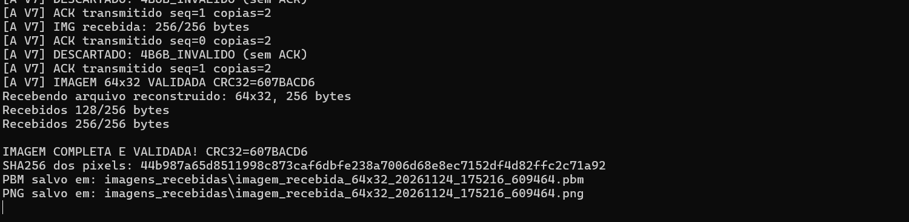
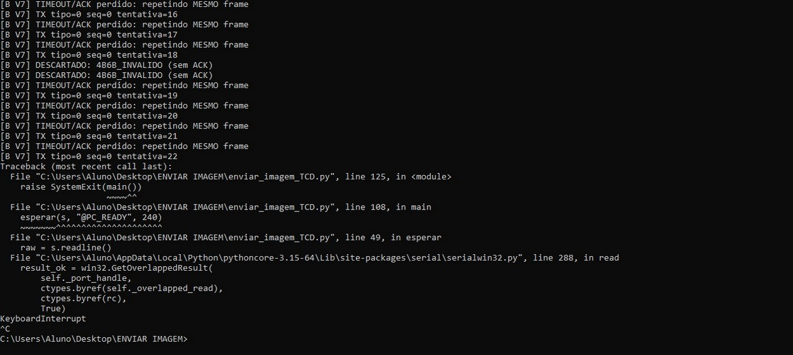

# T14 — Imagem 64×32 B → A

[Voltar à galeria](../README.md) · [Relatório de ensaios (PDF)](../../Relatorio_Ensaios_V7.pdf)

256/256 bytes, 1,15 m, tempo estimado de 120–180 s na tentativa bem-sucedida, CRC32 607BACD6; SHA-256 dos pixels coincidente. Primeira tentativa interrompida; nova sessão confirmou cabeçalho na quarta tentativa e END na segunda.

## Evidências visuais

Figuras extraídas do relatório de ensaios de 24/11/2026; não são novas medições.

**PBM reconstruído em A, ampliado**

**Montagens e trena**

**B: parâmetros e hashes antes do envio**

**B: envio completo e END confirmado**

**A: validação, hashes e arquivos salvos**

**Primeira tentativa: timeouts e interrupção manual**

