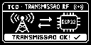

# Artes e imagens de referência para a transmissão

[Voltar ao acervo](../README.md)

5 imagens organizadas no pacote local. A imagem de referência 128×64 está disponível nesta pasta; demais arquivos a anexar.

<!-- TCD-GALERIA-INICIO -->
## Galeria de imagens

Total de arquivos: 1.

<!-- TCD-GALERIA-FIM -->
